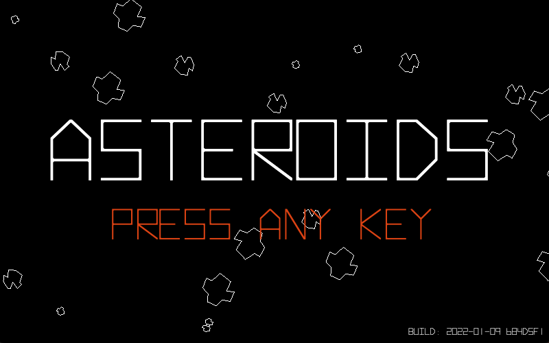

# James Emmrich **Founding / Principal Software Engineer | 0→1 Product Builder** 
I build software from early idea through working product, and I enjoy the engineering problems that appear along the way: architecture, product constraints, integrations, data, experimentation, and production systems. 

## What I Build
I work across 0→1 products, production applications, data-intensive systems, AI-enabled experiences, and growth-oriented product engineering. I’m particularly interested in turning ambiguous ideas into working software, then improving the architecture, reliability, developer experience, and product experience as the system matures. 

## How I Work
I start with the problem and the constraints, then choose the simplest architecture that can support the next stage of the product. I validate assumptions early, make explicit build-versus-buy decisions, and keep a path open for iteration. I care about maintainability and operational reality, while avoiding solving tomorrow’s scale problem before today’s product exists. 

## 0→1 Product Building
One of the clearest examples of my 0→1 work is MotoRegistry, a niche SaaS platform I founded and engineered for motorsport clubs and race organizers. I took the product from concept through operation, owning product management, full-stack development, UI/UX, customer support, and infrastructure. 

## Engineering at Scale 
My engineering experience also includes production systems where reliability, architecture, security, integrations, and operational behavior matter. At PagerDuty, I architected AEMS, an event-driven Kafka-based messaging workflow supporting approximately 750,000 weekly recipients. 

## AI & Modern Engineering
AI is increasingly part of how I prototype, build, and explore product ideas. I use AI-assisted development and external LLM APIs where they shorten the path from concept to working software, while keeping engineering judgment, product constraints, and system behavior in view. 

## Selected Projects 
I use this profile to share projects that demonstrate how I approach product development, architecture, experimentation, and modern engineering. See the pinned repositories for the projects I consider most representative. 

## Technical Stack 
JavaScript · TypeScript · Elixir · React · Node.js · Deno · React Native · Phoenix · REST APIs · Microservices · Kafka · PostgreSQL · MySQL · Supabase · WebGL · CI/CD · Git · Generative AI · LLM APIs 

## Building in Public 
I’m interested in practical engineering, unusual product ideas, and the process of turning an ambiguous problem into something people can actually use.

# Project: Asteroids

## Why I Built This
I started experimenting with ThreeJs/WebGL to explore line drawing. Within a few hours, I realized I'd accidentally built the core mechanics of Asteroids—a game whose elegantly simple design has always been a favorite of mine.

## Architecture
The core architecture is built on a custom Entity Component System (ECS) design. While the game appears 2D, it actually renders in 3D with a locked 2D perspective—a foundation that would let me transition the player into 3D as part of the game loop, bonus rounds, or as a hidden feature. 

## Key Technical Decisions
I started with a traditional object-oriented approach but rewrote it to explore Entity Component System architecture. The composition-based design proved much more flexible for expansion and maintenance—an approach I've come to really enjoy. 

## Technology
TypeScript, Deno, Deno Deploy, ThreeJs/WebGL

## What I Learned
Building this project introduced me to the Entity Component System architecture and how powerful composition is for game design. It also sparked a deep dive into ID Software's source code—studying Catacomb 3D, Wolfenstein 3D, and DOOM to understand how each iteration of their engines evolved and influenced modern game architecture.

## Future Improvements
* Fix a few small bugs
* Get aliens spawning and actively hunting the player
* Implement a backend API to track player scores globally
* Explore different collision detection systems and other game architecture concepts
* Expand the game engine to be more universal 

## Demo / Screenshots

Live Demo: [https://asteroids.philtech.ventures/](https://asteroids.philtech.ventures/)